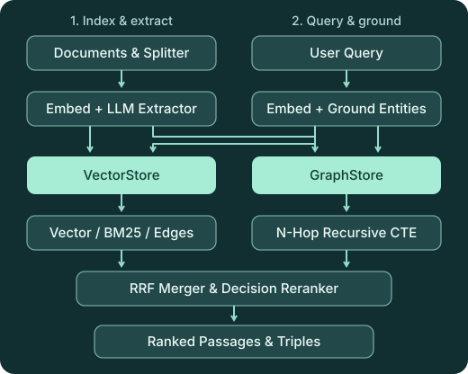

Vector search is great when the answer lives inside a single passage. Ask a question whose answer spans two or three connected documents, though, and top-K cosine similarity hits a wall: the chunk that matches your question mentions an intermediate entity, while the actual answer lives in a different chunk that never uses the words from your prompt.

Loom gives you two complementary GraphRAG primitives—both implementing [`retriever.Retriever`](https://pkg.go.dev/github.com/masterkeysrd/loom/retriever#Retriever)—so you can start lightweight over an existing vector store and graduate to a full entity–relationship knowledge graph when your domain needs it. This guide introduces the GraphRAG patterns Loom supports and walks through building an end-to-end architecture assistant that traces multi-hop service dependencies.



## GraphRAG patterns

Depending on how structured your data already is, you can combine Loom’s retrieval primitives in a few ways:

- **Metadata-edge traversal**: Your chunks already carry links—Markdown `parent_id` headers, hyperlinks, code imports, citations, or shared `entities` tags. `retriever.NewGraphRetriever` seeds with vector search, walks those metadata edges hop-by-hop over your existing `vectorstore.VectorStore`, and ranks the neighborhood with score decay (`TraversalEager`) or diversity (`TraversalMMR`). No graph store required.
- **Entity–relationship knowledge graph**: Your relationships live inside unstructured prose. `graphstore.Extractor` uses structured LLM outputs to extract typed nodes and edges into a `graphstore.GraphStore` (`memory`, `sqlite`, or `pg`), and `retriever.FromGraphStore` grounds entities from the user’s query and traverses their N-hop neighborhood.
- **Hybrid GraphRAG**: Pair `retriever.FromGraphStore` with `retriever.FromVectorStore` and `retriever.NewBM25` inside `retriever.NewMerger` (Reciprocal Rank Fusion), then optionally prune noisy hops with a fast [`decision.Model`](./decision.md) via `retriever.NewDecisionReranker`. The model gets both exact multi-hop topology and verbatim source passages.

> **Why `graphstore` and not `graph`?** Top-level [`graph`](./graphs.md) is Loom’s stateful agent workflow runtime (`graph.New`, `Node`, `Command`). Knowledge-graph storage lives in **`graphstore`** (`github.com/masterkeysrd/loom/graphstore`), mirroring `vectorstore` and `store`.

---

## Why graph retrieval matters

Consider a small set of internal architecture docs:

- **`arch-1`**: *"Checkout API routes every incoming order validation request to Auth Service and Billing Service."*
- **`arch-2`**: *"Auth Service issues OAuth tokens and depends on Redis Cluster for low-latency session revocation."*
- **`arch-3`**: *"Billing Service writes ledger transactions to PostgreSQL Primary and publishes events to Kafka."*

Now ask a multi-hop operational question:

> Which datastore is impacted if the Checkout API triggers an Auth Service outage?

With plain vector search, `arch-1` scores highest because it mentions both **Checkout API** and **Auth Service**, while `arch-2`—the passage that actually names **Redis Cluster**—may rank behind `arch-3` (which mentions **PostgreSQL** and **Kafka**, strong lexical matches for "datastore"). Following the relationship chain `Checkout API -[CALLS]-> Auth Service -[DEPENDS_ON]-> Redis Cluster` makes the answer unambiguous in two hops.

### What you will build

1. **Start lightweight**: Traverse explicit document links over your existing vector store with `retriever.NewGraphRetriever`.
2. **Extract a typed graph**: Turn unstructured prose chunks into ontology-constrained nodes and edges with `graphstore.Extractor`.
3. **Store and traverse**: Persist the graph in SQLite (or in-memory / PostgreSQL) and query N-hop neighborhoods with cycle-safe recursive SQL CTEs.
4. **Fuse and answer**: Combine vector search, BM25, and knowledge graph traversal via `retriever.NewMerger` inside a Loom workflow.

---

## Option 1: Traverse metadata edges without a graph store

If your documents already carry links in metadata—such as `links_to` IDs, `parent_id` sections, or shared `entities` slices—you can get multi-hop retrieval directly on top of `vectorstore.VectorStore` (`memory`, `sqlite`, or `pg`).

Every Loom vector store supports direct ID lookup (`VectorStore.Get`), candidate-ID scoping (`vectorstore.WithIDs`), and slice/set-overlap metadata filters. `retriever.NewGraphRetriever` builds on those primitives to run a cycle-safe breadth-first walk from your initial vector seeds:

```go
import (
    "github.com/masterkeysrd/loom/document"
    "github.com/masterkeysrd/loom/retriever"
    "github.com/masterkeysrd/loom/vectorstore/memory"
)

vs := memory.New(embedModel)
_, err := vs.Add(ctx, []document.Document{
    document.New("Checkout API routes validation requests to Auth Service.").
        WithID("arch-1").
        WithMetadata("links_to", []string{"arch-2"}).
        WithMetadata("entities", []string{"Checkout API", "Auth Service"}),
    document.New("Auth Service depends on Redis Cluster for session revocation.").
        WithID("arch-2").
        WithMetadata("entities", []string{"Auth Service", "Redis Cluster"}),
})

graphRet := retriever.NewGraphRetriever(
    vs,
    []retriever.EdgeSpec{
        // Follow arch-1.Metadata["links_to"] -> Document.ID ("$id")
        {SourceKey: "links_to", TargetKey: retriever.DocumentIDKey},
        // Or link documents that share any entity in Metadata["entities"]
        {SourceKey: "entities", TargetKey: "entities"},
    },
    retriever.WithGraphMaxDepth(2),
    retriever.WithGraphStartK(2),
    retriever.WithGraphDepthDecay(0.85),
    retriever.WithGraphStrategy(retriever.TraversalMMR),
)

docs, err := graphRet.Retrieve(ctx, "Which datastore does Checkout API depend on?", retriever.WithTopK(4))
```

By default, `TraversalEager` scores each hop with exponential decay (`score(u) * decay^depth`) so closer hops rank above distant ones. Switch to `TraversalMMR` (and tune `WithGraphMMRLambda`) when expanded neighborhoods contain near-duplicate chunks—Loom re-ranks the discovered candidate IDs inside the vector store using their already-stored vectors, with no extra embedding calls.

---

## Option 2: Build a Knowledge Graph RAG pipeline

When relationships are buried in free-form text rather than explicit metadata links, extract them into a `graphstore.GraphStore`.

### 1. Extract typed nodes and edges

Unconstrained LLM extraction quickly drifts—one chunk emits `USES`, the next emits `DEPENDS_ON`, and a third invents `RELIES_UPON`. `graphstore.Extractor` avoids schema drift by compiling your allowed entity and relationship types into JSON Schema `enum` constraints and invoking [`llm.Model.WithStructuredOutput`](./llm/generation.md).

You can also supply `graphstore.TripleRule` constraints to drop edges that violate your domain ontology (leaving any field empty as a wildcard):

```go
import "github.com/masterkeysrd/loom/graphstore"

extractor, err := graphstore.NewExtractor(
    chatModel,
    graphstore.WithAllowedNodeTypes("Service", "Infrastructure"),
    graphstore.WithAllowedEdgeTypes("CALLS", "DEPENDS_ON", "WRITES_TO", "PUBLISHES_TO"),
    graphstore.WithAllowedTriples(
        graphstore.TripleRule{SourceType: "Service", EdgeType: "CALLS", TargetType: "Service"},
        graphstore.TripleRule{SourceType: "Service", EdgeType: "DEPENDS_ON", TargetType: "Infrastructure"},
        graphstore.TripleRule{SourceType: "Service", EdgeType: "WRITES_TO", TargetType: "Infrastructure"},
        graphstore.TripleRule{SourceType: "Service", EdgeType: "PUBLISHES_TO", TargetType: "Infrastructure"},
    ),
    graphstore.WithConcurrency(4),
)
if err != nil {
    return err
}

graphDocs, err := extractor.Extract(ctx, chunks)
```

For each chunk, the extractor normalizes entity IDs to canonical snake_case (`"Auth Service"` → `"auth_service"`) while keeping the readable display label, strips any accidental Markdown code fences, validates every triple, and stamps `Edge.DocID` with the source chunk’s `Document.ID` for provenance tracking.

### 2. Choose a graph store backend

Loom ships three zero-bloat `graphstore.GraphStore` backends with identical namespace (`"default"`), `Upsert`, `SearchNodes`, `Traverse`, and `Delete` semantics:

- **In-memory (`graphstore/memory`)** for tests, prototypes, and ephemeral workflows. Uses `internal/bm25` with substring fallback for zero-LLM lexical grounding, plus optional `memory.WithEmbedding(embedModel)` for semantic entity lookup.
- **SQLite (`graphstore/sqlite`)** for single-node apps and local agents. Built on pure-Go `modernc.org/sqlite` (`CGO_ENABLED=0`) with WAL mode, an automatically maintained `FTS5` `trigram` index (`bm25()`), optional `loom_vec_cosine` semantic scoring, and cycle-safe `WITH RECURSIVE` CTE traversal.
- **PostgreSQL (`graphstore/pg`)** for production and multi-instance deployments. Uses `pg_trgm` (`GIN (label gin_trgm_ops)`) for typo-tolerant entity grounding, optional `pgvector` HNSW indexes (`pg.WithEmbedding` / `pg.WithDims`), and native PostgreSQL 14+ `WITH RECURSIVE ... SEARCH BREADTH FIRST ... CYCLE` CTEs—working on AWS RDS, Aurora, Cloud SQL, Supabase, and Neon without requiring Apache AGE.

Here is how you persist the extracted `graphDocs` into SQLite:

```go
import (
    "database/sql"
    _ "modernc.org/sqlite"

    gssqlite "github.com/masterkeysrd/loom/graphstore/sqlite"
)

db, err := sql.Open("sqlite", "knowledge.db")
if err != nil {
    return err
}

// Pass WithEmbedding(embedModel) to resolve aliases like "k8s" -> "Kubernetes",
// or omit it for fast pure-FTS5 lexical grounding.
gs, err := gssqlite.New(db, gssqlite.WithEmbedding(embedModel))
if err != nil {
    return err
}

if err := gs.Upsert(ctx, graphDocs); err != nil {
    return err
}
```

When a source document is updated or removed, clean up its provenance edges with `gs.Delete(ctx, []string{"arch-2"}, graphstore.WithDeleteByDocID(true))` before re-upserting.

### 3. Retrieve neighborhoods and hydrate provenance

Wrap the graph store with `retriever.FromGraphStore` to turn multi-hop subgraphs into standard Loom `[]document.Document` results:

```go
kgRetriever := retriever.FromGraphStore(gs,
    retriever.WithGraphStoreMaxDepth(2),
    retriever.WithGraphStoreSeedK(5),
    retriever.WithGraphStoreRenderMode(retriever.RenderHybrid),
    retriever.WithGraphStoreDocumentStore(vs),
    retriever.WithQueryEntityExtractor(chatModel),
)
```

A few choices shape how `KnowledgeGraphRetriever` behaves at query time:

- **Grounding mode**: By default, `FromGraphStore` calls `gs.SearchNodes` directly (fast, zero LLM calls—backed by BM25/FTS5/`pg_trgm` or node embeddings). Add `WithQueryEntityExtractor(chatModel)` when users ask long conversational questions so a fast structured call extracts entity names before grounding.
- **Traversal bounds**: Traversal is bidirectional by default (`WithGraphStoreBidirectional(true)`), capped at `MaxDepth = 2`, `MaxEdges = 50`, and `MaxNodes = 100`. Narrow noisy graphs with `WithGraphStoreNodeTypes(...)` or `WithGraphStoreEdgeTypes(...)`.
- **Render mode**:
  - `RenderTriples` *(default)* emits a compact neighborhood document per grounded seed entity (`Metadata["source_type"] = "knowledge_graph"`):
    ```text
    Entity: Auth Service (Service)
    Relationships:
    - Auth Service (Service) -[DEPENDS_ON]-> Redis Cluster (Infrastructure)
    - Checkout API (Service) -[CALLS]-> Auth Service (Service)
    ```
  - `RenderProvenance` fetches the original prose chunks referenced by `Subgraph.SourceIDs` from `WithGraphStoreDocumentStore(vs)`.
  - `RenderHybrid` returns both the structured relationship summary and the underlying verbatim chunks.

### 4. Fuse with vector search, BM25, and reranking

Because `FromGraphStore` implements `retriever.Retriever`, hybrid GraphRAG needs no custom glue—pass it straight into `retriever.NewMerger` alongside your vector and BM25 retrievers, prune multi-hop noise with `retriever.NewDecisionReranker`, or expose the whole stack to an agent via `retriever.NewTool`:

```go
vecRetriever := retriever.FromVectorStore(vs, retriever.WithTopK(6))
bm25Retriever := retriever.NewBM25(chunks)

hybrid := retriever.NewMerger(
    []retriever.Retriever{vecRetriever, bm25Retriever, kgRetriever},
    retriever.WithRRFConstant(60),
)

// Optional: prune noisy multi-hop triples with a fast System One model
reranked := retriever.NewDecisionReranker(
    hybrid,
    decisionModel,
    "Does this context contain facts or relationships relevant to answering the query?",
    retriever.WithThreshold(0.60),
)

// Expose directly as a read-only agent tool
searchTool, err := retriever.NewTool(
    "search_knowledge_graph",
    "Search architecture passages and multi-hop service dependencies",
    reranked,
    retriever.WithTopK(6),
)
```

---

## Inspecting GraphRAG in Loom Studio

Both `NewGraphRetriever` (`graph_vector`) and `FromGraphStore` (`knowledge_graph`) wrap execution with `retriever.TelemetryMiddleware`. Whenever OpenTelemetry or a stream writer is active, each call records a `retrieve <name>` span with `loom.retriever.max_depth`, `loom.retriever.strategy`, `loom.retriever.hops`, and `loom.retriever.result_count`, and streams `"on_retrieve"` events so you can inspect the exact triples and hydrated passages inside [Loom Studio](./observability.md).

---

## Run the complete example

The runnable example in [`examples/graph_rag/main.go`](https://github.com/masterkeysrd/loom/blob/main/examples/graph_rag/main.go) wires the entire pipeline—`vectorstore/memory`, `graphstore.Extractor`, `graphstore/sqlite`, `retriever.FromGraphStore`, `retriever.NewMerger`, and a `retrieve -> generate` Loom graph workflow:

```bash
# Run locally with Ollama (gemma3 + nomic-embed-text):
go run ./examples/graph_rag -provider ollama

# Or run with OpenAI:
export OPENAI_API_KEY="sk-..."
go run ./examples/graph_rag -provider openai \
  -query "Which datastore is impacted if the Checkout API triggers an Auth Service outage?"
```

## Next steps

- Review the core [RAG guide](./rag.md) for document loaders, Markdown/recursive splitters, and vector store setup.
- Pair GraphRAG with [Decision Models](./decision.md) to prune noisy multi-hop neighborhoods at low latency.
- Expose your hybrid retriever to an autonomous agent loop using the [Tools guide](./tools.md).
