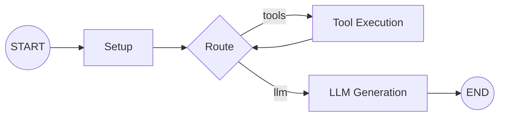
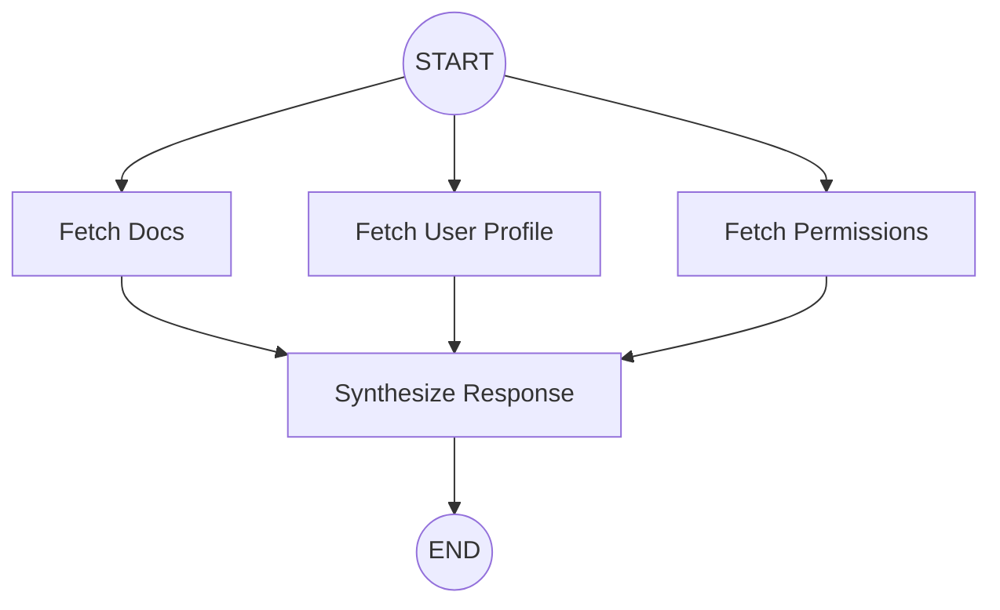
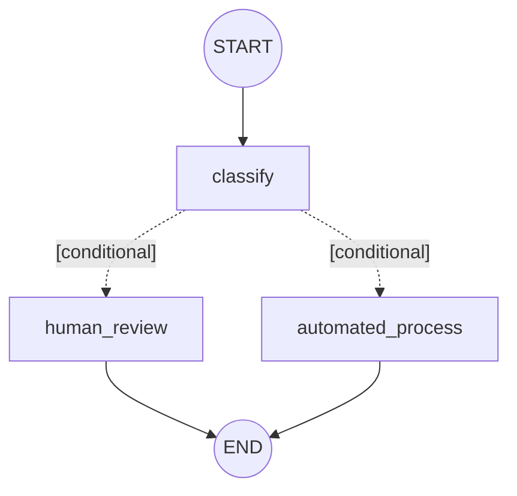

# Graph Workflows 🕸️

The `graph` package is the core execution engine of Loom. It provides primitives for defining, executing, streaming, and persisting multi-step AI agent workflows as directed graphs.

Loom is built on a **State-First** architecture. Rather than managing sprawling control flow, nested loops, and side-effects in unstructured application code, you define an explicit graph where each node transforms a strongly-typed shared state.



---

## Architecture & Core Primitives

| Component | Type / Interface | Responsibility |
|---|---|---|
| **State** | `graph.State[T]` | Shared workflow memory. Must implement `Copy() T`. |
| **Builder** | `*graph.Builder[S]` | Fluent API for registering nodes, edges, middleware, safety limits, and persistence. |
| **Node** | `graph.Node[S]` | A unit of execution that accepts the current state and returns a `Command`. |
| **Node Function** | `graph.NodeFunc[S]` | Adapter function to convert standard Go functions into a `graph.Node[S]`. |
| **Edge** | Direct, Conditional, Route | Defines transitions between nodes. |
| **Command** | `graph.Command[S]` | Instructions returned by nodes (`Update`, `Interrupt`, `InterruptUpdate`). |
| **Graph** | `*graph.Graph[S]` | Immutable, compiled workflow engine created by `builder.Build()`. |
| **Snapshot** | `graph.Snapshot[S]` | Point-in-time state snapshot including current values, next nodes, and location metadata. |

---

## 1. State (`graph.State[T]`)

Every Loom workflow operates on a user-defined Go struct that satisfies the generic `graph.State[T]` interface:

```go
type State[T any] interface {
    Copy() T
}
```

### Writing a State Struct

Because Loom executes parallel nodes concurrently and supports checkpointing and time-travel, your `Copy()` method must ensure deep copy isolation for reference types (slices, maps, nested pointers):

```go
package main

import "github.com/masterkeysrd/loom/message"

type AgentState struct {
    Query       string              `json:"query"`
    Messages    message.MessageList `json:"messages"`
    Iteration   int                 `json:"iteration"`
    NeedsReview bool                `json:"needs_review"`
    Output      string              `json:"output"`
}

// Copy creates an isolated copy of AgentState to prevent race conditions during execution.
func (s AgentState) Copy() AgentState {
    clone := s
    if s.Messages != nil {
        clone.Messages = make(message.MessageList, len(s.Messages))
        copy(clone.Messages, s.Messages)
    }
    return clone
}
```

> [!TIP]
> Ensure all exported state fields include `json` tags. Loom checkpointers decompose state into channel-level JSON keys during persistence.

---

## 2. Commands: Directing the Engine

Nodes return a `graph.Command[State]` (and optional `error`) to notify the engine how state should change and whether execution should continue.

```go
type Command[State any] interface {
    Apply(State) State
}
```

### Built-in Commands

- **`graph.Update[State](fn)`**: Modifies state using a transformation function `func(State) State`.
  ```go
  return graph.Update[AgentState](func(s AgentState) AgentState {
      s.Iteration++
      return s
  }), nil
  ```

- **`graph.Interrupt()`**: Halts graph execution immediately. Loom persists the checkpoint to the configured checkpointer and returns the paused `Snapshot` to the caller.
  ```go
  if s.NeedsReview {
      return graph.Interrupt(), nil
  }
  ```

- **`graph.InterruptUpdate[State](fn)`**: Modifies state *and* interrupts execution in a single atomic step. Used when a node (such as a sub-graph or a human-in-the-loop approval step) needs to record partial results before pausing.
  ```go
  return graph.InterruptUpdate[AgentState](func(s AgentState) AgentState {
      s.Output = "Waiting on user confirmation"
      return s
  }), nil
  ```

---

## 3. Nodes & Edges

### Defining Nodes with `graph.NodeFunc`

A node implements the `graph.Node[State]` interface:

```go
type Node[State any] interface {
    Execute(context.Context, State) (Command[State], error)
}
```

Wrap inline functions cleanly with `graph.NodeFunc[State]`:

```go
classifierNode := graph.NodeFunc[AgentState](func(ctx context.Context, state AgentState) (graph.Command[AgentState], error) {
    needsReview := len(state.Query) > 500
    return graph.Update[AgentState](func(s AgentState) AgentState {
        s.NeedsReview = needsReview
        return s
    }), nil
})
```

### Wiring Edges

Loom provides three types of edges to connect nodes:

1. **Unconditional Edges (`AddEdge`)**:
   Always transitions from source to destination.
   ```go
   builder.AddEdge(graph.START, "classify")
   builder.AddEdge("execute", "summarize")
   builder.AddEdge("summarize", graph.END)
   ```

2. **Conditional Edges (`AddConditionalEdge`)**:
   Branches based on a boolean predicate evaluated against current state.
   ```go
   builder.AddConditionalEdge("classify", "human_review", func(s AgentState) bool {
       return s.NeedsReview
   })
   builder.AddConditionalEdge("classify", "automated_process", func(s AgentState) bool {
       return !s.NeedsReview
   })
   ```

3. **Route Edges (`AddRouteEdge`)**:
   Computes a route key dynamically and maps it to a target node.
   ```go
   builder.AddRouteEdge("decide", func(s AgentState) (string, error) {
       if s.Iteration > 3 {
           return "escalate", nil
       }
       return "retry", nil
   }, map[string]string{
       "escalate": "manager_review",
       "retry":    "worker_node",
   })
   ```

> [!NOTE]
> `graph.START` and `graph.END` are reserved virtual nodes representing graph entry and termination points.

---

## 4. Parallel Node Execution (Fan-out / Fan-in)

Loom natively supports concurrent execution. When multiple outgoing edges emerge from a node (or from `START`), the engine executes target nodes in parallel using goroutines.



```go
builder := graph.New[AgentState]()

// Fan-out: START branches into three parallel nodes
builder.AddEdge(graph.START, "fetchDocs")
builder.AddEdge(graph.START, "fetchUserProfile")
builder.AddEdge(graph.START, "fetchPermissions")

// Fan-in: all branches converge on a single aggregator node
builder.AddEdge("fetchDocs", "synthesize")
builder.AddEdge("fetchUserProfile", "synthesize")
builder.AddEdge("fetchPermissions", "synthesize")
builder.AddEdge("synthesize", graph.END)
```

### Parallel Execution Semantics

- **State Isolation**: Before invoking each branch, Loom clones the current snapshot via `snapshot.State.Copy()`. Parallel nodes execute concurrently without shared memory race conditions.
- **Deterministic Merge**: Commands returned by parallel nodes are collected and applied sequentially in slice/edge order:
  ```go
  applyAll := func(s State) State {
      for _, cmd := range cmds {
          if cmd != nil {
              s = cmd.Apply(s)
          }
      }
      return s
  }
  ```
- **Fan-in Deduplication**: When multiple parallel edges converge on the same target (such as `"synthesize"` above), Loom deduplicates the downstream node list while preserving encounter order. The join node runs **exactly once**.
- **Error Handling**: If any concurrent node returns an error, execution stops immediately, and Loom returns the first encountered error formatted as `failed to execute node: %w`.
- **Interrupt Handling**: If any concurrent node returns an `Interruptable` command (like `Interrupt()` or `InterruptUpdate`), the merged result is promoted to an interrupt, pausing execution and saving the updated state.
- **Safety Step Tracking**: Every executed parallel node increments the execution step counter against the configured `WithMaxSteps` limit.

---

## 5. Sub-graphs as Nodes (`AsNode` & `MapNode`)

Sub-graphs enable composable, hierarchical agent architectures. A sub-graph is an independently defined, fully compiled `Graph` embedded as a node inside a parent graph.

### Same-State Sub-graphs (`childGraph.AsNode()`)

When child and parent share the exact same state struct, convert the compiled child graph directly with `.AsNode()`:

```go
// 1. Build the child research graph
childBuilder := graph.New[AgentState]().WithName("researcher")
childBuilder.AddNode("search", searchNode)
childBuilder.AddNode("summarize", summarizeNode)
childBuilder.AddEdge(graph.START, "search")
childBuilder.AddEdge("search", "summarize")
childBuilder.AddEdge("summarize", graph.END)
childGraph, _ := childBuilder.Build()

// 2. Embed inside parent coordinator graph
parentBuilder := graph.New[AgentState]().WithName("coordinator")
parentBuilder.AddNode("setup", setupNode)
parentBuilder.AddNode("research", childGraph.AsNode()) // <-- Sub-graph node
parentBuilder.AddNode("deliver", deliverNode)

parentBuilder.AddEdge(graph.START, "setup")
parentBuilder.AddEdge("setup", "research")
parentBuilder.AddEdge("research", "deliver")
parentBuilder.AddEdge("deliver", graph.END)

parentGraph, _ := parentBuilder.Build()
```

### Different-State Sub-graphs (`graph.MapNode`)

When a sub-graph requires a specialized child state, use `graph.MapNode` to adapt parent state to child state and back:

```go
type ParentState struct {
    UserID      string `json:"user_id"`
    RawQuestion string `json:"raw_question"`
    Answer      string `json:"answer"`
}

func (s ParentState) Copy() ParentState { return s }

type MathState struct {
    Expression string  `json:"expression"`
    Result     float64 `json:"result"`
}

func (s MathState) Copy() MathState { return s }

// childMathGraph operates on MathState
mathGraph, _ := mathBuilder.Build()

// Adapt mathGraph to parent's ParentState
mathNode := graph.MapNode(
    mathGraph.AsNode(),
    // toChild: extract ChildState from ParentState
    func(parent ParentState) MathState {
        return MathState{Expression: parent.RawQuestion}
    },
    // fromChild: integrate ChildState updates back into ParentState
    func(parent ParentState, child MathState) ParentState {
        parent.Answer = fmt.Sprintf("Result: %.2f", child.Result)
        return parent
    },
)

parentBuilder.AddNode("calculator", mathNode)
```

### Hierarchical Checkpoint Namespaces

When saving checkpoints across nested sub-graphs, Loom scopes state storage into LangGraph-style hierarchical namespaces:

$$\text{CheckpointNS} = \langle\text{parent\_ns}\rangle \mid \langle\text{node\_name}\rangle:\langle\text{task\_id}\rangle$$

Examples:
- Root level: `""` (empty string)
- First sub-graph level: `"research:83a1b0fe..."`
- Nested sub-graph level: `"research:83a1b0fe...|web_search:c593d18e..."`

#### Namespace Guarantees:
1. **Deterministic Task IDs**: Loom derives `task_id` deterministically via SHA-1 of `(ThreadID, CheckpointNS, Step, NodeName)`.
2. **Interrupt & Resume Isolation**: When a sub-graph interrupts, the parent location preserves the execution step counter. On resume, the sub-graph receives the exact same `CheckpointNS` and picks up directly from its last saved child checkpoint.
3. **Loop Separation**: Loops across distinct graph steps compute different task IDs, preventing collisions across repeated iterations.
4. **Node Name Restrictions**: Because `|` is the namespace separator (`NSSep`) and `:` is the task separator (`NSEnd`), node names **cannot** contain `|` or `:`. Slashes (e.g. `"tools/search"` or `"agent/writer"`) are fully supported.

### Interrupt Propagation

If any node inside a sub-graph returns an `Interrupt()` or `InterruptUpdate`:
1. Sub-graph execution halts and persists its internal child checkpoint.
2. `AsNode()` or `MapNode` catches the incomplete snapshot (`!snap.IsDone()`).
3. `AsNode()` / `MapNode` returns an `InterruptUpdate` command to the parent engine.
4. The parent graph pauses, records all mutations up to the interrupt point, and returns the snapshot to the caller.

---

## 6. Execution Safety (`WithMaxSteps`)

Cyclic agent workflows (e.g. reflection loops, tool-retry cycles) can risk infinite execution if an exit condition is never reached. Loom provides rigorous safeguards:

```go
builder := graph.New[AgentState]().
    WithMaxSteps(25) // Limit total node executions to 25

g, _ := builder.Build()

snapshot, err := g.Execute(ctx, initialCmd, nil)
if errors.Is(err, graph.ErrMaxStepsExceeded) {
    log.Printf("Safety limit reached: %v", err)
}
```

- **Step Counting**: Virtual `START` is not counted. Each invoked user node (including parallel nodes) increments the step count.
- **Dynamic Override**: You can also set or adjust limits after building via `g.SetMaxSteps(limit)`.
- **Context Cancellation**: Loom validates `ctx.Err()` at every loop iteration and aborts immediately if a context deadline or cancellation occurs.

---

## 7. Node Middleware & Retry Policies

Loom middleware allows you to intercept, wrap, log, and retry user node executions without polluting node business logic.

```go
type Middleware[S any] func(Node[S]) Node[S]
```

Middlewares are applied in registered order (outermost first) and wrap only real user nodes (virtual `START` and `END` are never wrapped).

```go
func LoggingMiddleware[S any](logger *log.Logger) graph.Middleware[S] {
    return func(next graph.Node[S]) graph.Node[S] {
        return graph.NodeFunc[S](func(ctx context.Context, state S) (graph.Command[S], error) {
            logger.Printf("entering node execution")
            cmd, err := next.Execute(ctx, state)
            logger.Printf("exiting node execution with err=%v", err)
            return cmd, err
        })
    }
}

builder.WithMiddleware(LoggingMiddleware[AgentState](logger))
```

### Configurable Retry Middleware (`RetryMiddleware`)

Loom provides a built-in exponential backoff `RetryMiddleware` for transient failures (e.g. network timeouts, LLM rate limits):

```go
retryPolicy := graph.RetryMiddleware[AgentState](
    graph.WithMaxAttempts(4),                    // Total attempts including initial call (default: 3)
    graph.WithInitialWait(200*time.Millisecond), // Initial wait duration (default: 100ms)
    graph.WithMaxWait(10*time.Second),           // Max wait cap (default: 5s)
    graph.WithMultiplier(2.0),                   // Exponential multiplier (default: 2.0)
    graph.WithShouldRetry(func(err error) bool { // Optional retry predicate
        // Skip retrying non-transient validation errors
        return !errors.Is(err, ErrBadRequest)
    }),
)

builder.WithMiddleware(retryPolicy)
```

#### Retry Middleware Safety:
- **State Isolation**: Before each retry attempt, `RetryMiddleware` clones state with `state.Copy()`, guaranteeing failed runs do not contaminate retry attempts.
- **Cancellation Awareness**: If `ctx.Done()` triggers during backoff wait or node execution, the middleware stops immediately and returns `ctx.Err()`.

---

## 8. Visualization (`ToMermaid` & `MermaidURL`)

Compile and visualize your graph structure for documentation, debugging, or Loom Studio rendering:

```go
g, _ := builder.Build()

// Generate raw Mermaid diagram definition
mermaidText := g.ToMermaid()
fmt.Println(mermaidText)

// Generate instant preview link via mermaid.ink
imageURL := g.MermaidURL()
fmt.Println("Graph Diagram Preview:", imageURL)
```

Example Mermaid output:


---

## 8. Compile-Time Graph Validation

Loom strictly validates graph topology and integrity when `builder.Build()` is called, catching structural configuration mistakes before execution begins:

```go
g, err := builder.Build()
if err != nil {
    log.Fatalf("invalid graph configuration: %v", err)
}
```

### Validation Guarantees:
- **Node Validation**: Node names cannot be empty, reserved (`START`, `END`), or contain namespace delimiters (`|`, `:`). Nodes cannot be `nil`.
- **Entry & Terminal Integrity**: The graph must declare at least one outgoing edge from `START`. The terminal `END` node cannot have outgoing edges.
- **Dead-End Detection**: Every user-defined node must define at least one outgoing edge (to another node or to `END`).
- **Edge & Target Integrity**: All edges must originate from known nodes and point to valid, registered destination nodes (edges cannot point back to `START`).
- **Edge Predicate Integrity**: Conditions for `ConditionalEdge` and routing functions/target maps for `RouteEdge` cannot be empty or `nil`.

---

## Next Steps

- [Persistence & State](./persistence.md): Explore SQLite, PostgreSQL, and checkpoint storage.
- [Human-in-the-Loop](./hitl.md): Build interactive approval and review loops.
- [Tools & Streaming](./tools.md): Stream LLM output and connect external agent tools.
- [RAG Workflows](./rag.md): Ingest documents, create vector stores, and retrieve knowledge.
