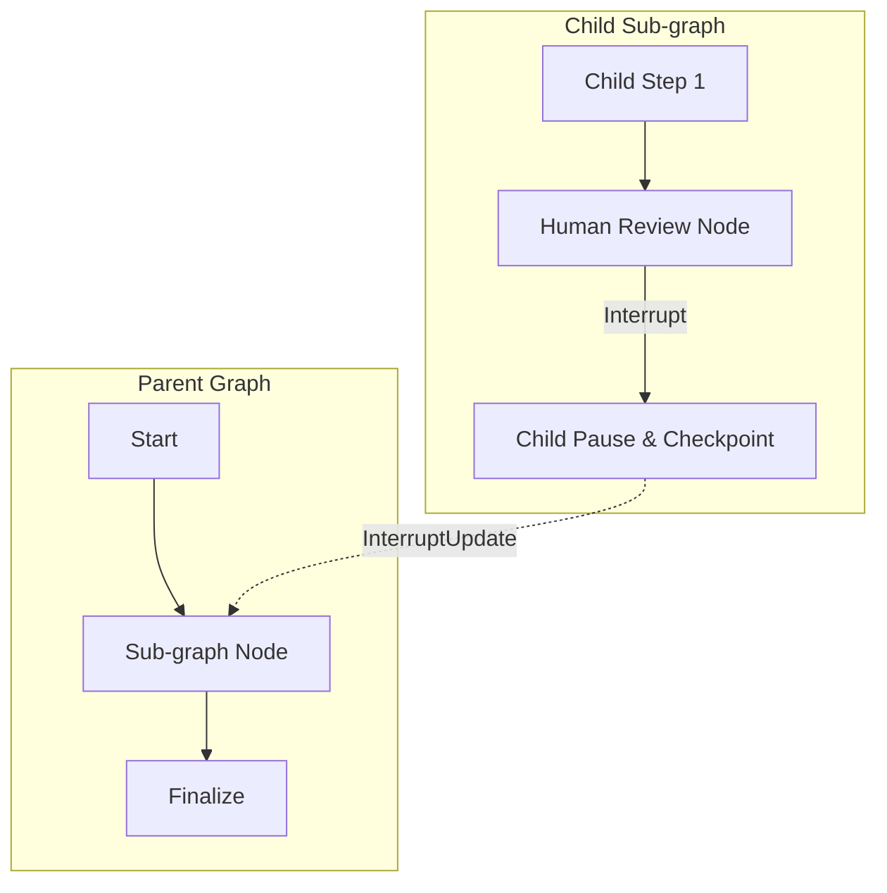

# Human-in-the-Loop (HITL) 🤝

Human-in-the-loop patterns allow you to pause an AI workflow and wait for human approval, clarification, or additional input. This is critical for high-stakes tasks where an LLM should not act autonomously (e.g., executing financial transactions, sending external emails, or approving destructive operations).

---

## 1. The Interrupt Pattern

Loom provides two first-class commands to pause execution and record checkpoints:

### Basic Interrupt: `graph.Interrupt()`

Use `graph.Interrupt()` to halt execution immediately without modifying the state. Loom persists the current state to the configured checkpointer and returns the paused `Snapshot` to the caller.

```go
builder.AddNode("Review", graph.NodeFunc[MyState](func(ctx context.Context, s MyState) (graph.Command[MyState], error) {
    if s.RequiresApproval && !s.IsApproved {
        // Stop execution and save checkpoint
        return graph.Interrupt(), nil 
    }
    return graph.Update[MyState](func(s MyState) MyState { return s }), nil
}))
```

### Interrupt with State Update: `graph.InterruptUpdate[S]`

Often an agent must mutate the state before pausing—for example, recording the question being asked to the human, updating a status flag to `"awaiting_approval"`, or caching draft responses:

```go
builder.AddNode("PrepareApproval", graph.NodeFunc[MyState](func(ctx context.Context, s MyState) (graph.Command[MyState], error) {
    // Modify state AND pause execution in a single atomic operation
    return graph.InterruptUpdate[MyState](func(state MyState) MyState {
        state.Status = "awaiting_human_approval"
        state.ReviewPrompt = "Please confirm the transfer of $5,000 to Account #1234."
        state.PendingActionID = "tx-994"
        return state
    }), nil
}))
```

`graph.InterruptUpdate[S]` implements `graph.Interruptable`. When the engine detects this command, it applies the state transformation, marks the snapshot as interrupted (`!snapshot.IsDone()`), and persists the updated state into the checkpoint before returning.

---

## 2. Waiting for Input & Resuming

When a graph interrupts, `Graph.Execute` returns a `Snapshot` whose `IsDone()` method returns `false`. You can present the current state to a user (e.g., via a web UI, Slack bot, or CLI) and wait for feedback:

```go
// 1. Initial execution runs until PrepareApproval interrupts
snapshot, err := g.Execute(ctx, initialInput, &graph.Location{ThreadID: "order-994"})
if err != nil {
    log.Fatal(err)
}

if !snapshot.IsDone() {
    fmt.Printf("Workflow paused at step %d. Prompt: %s\n", snapshot.Location.CheckpointID, snapshot.State.ReviewPrompt)
}

// ... User clicks "Approve" in the dashboard ...

// 2. Resume execution by providing the human's input and passing the saved Location
humanInput := graph.Update[MyState](func(s MyState) MyState {
    s.IsApproved = true
    s.Status = "approved"
    return s
})

// Resume from the previous checkpoint location
resumedSnapshot, err := g.Execute(ctx, humanInput, &snapshot.Location)
```

---

## 3. Subgraph Interrupt Propagation (`AsNode` & `MapNode`)

When building modular, hierarchical agents with sub-graphs (`childGraph.AsNode()` or `graph.MapNode`), interrupt handling is fully transparent:



### How Subgraph Interrupts Work:
1. **Child Interruption**: When a node inside the sub-graph returns `graph.Interrupt()` or `graph.InterruptUpdate[ChildState]`, the child graph pauses and saves its internal checkpoint under its scoped namespace (e.g., `coordinator|reviewer:sha1...`).
2. **Parent Propagation**: `AsNode()` and `MapNode` detect that the sub-graph run did not complete (`!childSnapshot.IsDone()`). They wrap the child's partial state in a parent `InterruptUpdate` command.
3. **Parent Checkpointing**: The parent graph updates its state and pauses, creating a parent checkpoint.
4. **Seamless Resumption**: When you resume the parent graph via `g.Execute(ctx, input, &parentSnapshot.Location)`, the sub-graph is re-entered with the **exact same namespace and step index**, resuming the child graph directly from its paused state without restarting from the beginning.

---

## 4. State Forking (Time Travel)

Because Loom uses checkpoints, you can "go back in time" by resuming from an older checkpoint with different inputs. This is useful for testing different decision paths or correcting an agent's mistakes.

```go
// Resume from a specific historical checkpoint ID
forkLocation := &graph.Location{
    ThreadID:     "order-994",
    CheckpointID: "0194689b-8c81-7925-950e-b7d5eb85bf22", // Prior checkpoint ID
}

snapshot, err := g.Execute(ctx, correctionCommand, forkLocation)
```

---

## Summary

- **`graph.Interrupt()`**: Pause execution and save current state without mutations.
- **`graph.InterruptUpdate[S]`**: Atomically mutate state and trigger an interrupt.
- **Subgraph Propagation**: `AsNode()` and `MapNode` automatically bubble interrupts to the parent workflow while maintaining checkpoint namespaces.
- **Resumption**: Provide new input and resume from a saved `Location`.
- **Time Travel**: Fork from any historical `CheckpointID` to explore alternate execution branches.
