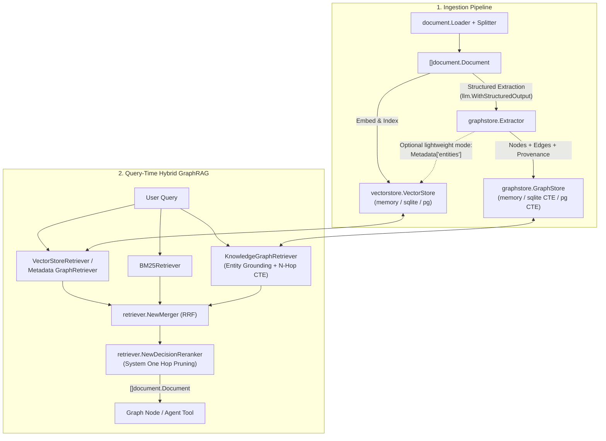

# Graph Retrievers & Knowledge Graph RAG (`GraphRAG`) — Architecture & Design

This document specifies the design for **Graph Retrieval** and **Knowledge Graph RAG (GraphRAG)** in Loom, extending the existing RAG stack ([`document`](document/document.go), [`vectorstore`](vectorstore/vectorstore.go), and [`retriever`](retriever/retriever.go)).

It synthesizes three proven industry patterns into an idiomatic, zero-bloat Go architecture:
1. **Metadata-Edge Graph Traversal** — multi-hop traversal over existing [`vectorstore.VectorStore`](vectorstore/vectorstore.go) backends using metadata links (`Eager` and `MMR` strategies) with no dedicated graph database required.
2. **Schema-Guided LLM Graph Extraction** (*Constructing Knowledge Graphs from Text via Structured Outputs / `LLMGraphTransformer`*) — converting [`document.Document`](document/document.go) chunks into typed nodes and edges using [`llm.Model.WithStructuredOutput`](llm/model.go) and [`jsonschema.Schema`](https://pkg.go.dev/github.com/google/jsonschema-go/jsonschema).
3. **Hybrid Structured + Unstructured RAG** (*Enhancing RAG Accuracy with Knowledge Graphs*) — pairing entity-grounded $N$-hop subgraph traversal with dense vector similarity, Okapi BM25, Reciprocal Rank Fusion ([`retriever.NewMerger`](retriever/retrievers.go)), and System One probabilistic pruning ([`retriever.NewDecisionReranker`](retriever/retrievers.go)).

---

## 1. Design Principles & Package Naming

1. **No Package Collision with `graph`:**
   - Top-level package [`graph`](graph/doc.go) is Loom's stateful agent orchestration runtime (`Builder`, `Graph`, `Node`, `Command`).
   - Knowledge-graph storage lives in **`graphstore`** (`github.com/masterkeysrd/loom/graphstore`), directly mirroring [`vectorstore`](vectorstore/vectorstore.go) and [`store`](store/store.go).
   - All query-time retrievers live in **[`retriever`](retriever/retriever.go)** and implement the standard [`retriever.Retriever`](retriever/retriever.go) interface.
2. **Zero Mandatory External Infrastructure:**
   - Just like `checkpoint`, `store`, and `vectorstore`, `graphstore` ships with first-class **`memory`**, **`sqlite`** (`modernc.org/sqlite`), and **`pg`** (`lib/pq`) backends powered by cycle-safe `WITH RECURSIVE` SQL CTEs.
   - Dedicated graph databases (e.g., Neo4j, FalkorDB, Memgraph) plug into the same `graphstore.GraphStore` interface as optional connectors without bloating core `go.mod`.
3. **Seamless Composition with Existing Primitives:**
   - Because every graph retriever returns `([]document.Document, error)`, it automatically inherits [`retriever.TelemetryMiddleware`](retriever/retriever.go) (`on_retrieve` stream events + OTel spans), [`retriever.NewMerger`](retriever/retrievers.go) (RRF), [`retriever.NewDecisionReranker`](retriever/retrievers.go), and [`retriever.NewTool`](retriever/retrievers.go).

---

## 2. End-to-End Architecture



---

## 3. Pillar 1: Metadata-Edge `GraphRetriever` (Over `VectorStore`)

Before introducing a separate graph store, many multi-hop RAG problems (navigating Markdown `parent_id` sections from [`MarkdownSplitter`](document/splitters.go), code imports, citations, hyperlinks, or shared extracted entities) can be solved directly on top of [`vectorstore.VectorStore`](vectorstore/vectorstore.go).

### 3.1 How It Works
1. **Seed Search (`StartK`):** Execute similarity search against `VectorStore` to retrieve initial entry-point documents.
2. **Metadata Link Extraction:** For each frontier document, read outgoing link values defined by `[]EdgeSpec` (e.g., `{SourceKey: "links_to", TargetKey: "id"}`, `{SourceKey: "parent_id", TargetKey: "id"}`, or symmetric `{SourceKey: "entities", TargetKey: "entities"}`).
3. **Hop Expansion (`MaxDepth`):** Query neighbor documents from the `VectorStore` whose `TargetKey` matches the frontier's `SourceKey` values, tracking visited `Document.ID`s to prevent cycles.
4. **Selection Strategy (`Eager` vs. `MMR`):**
   - **`TraversalEager` (BFS + Decay):** Scores traversed neighbors as $\text{score}(v) = \text{score}(u) \times \gamma^d$ (where $\gamma \in (0, 1]$ is `DepthDecay` and $d$ is hop depth), sorts descending, and truncates to `TopK`.
   - **`TraversalMMR` (Maximal Marginal Relevance):** Re-ranks the combined candidate pool (seeds + traversed neighbors) against the query vector using [`vectorstore.SelectMMR`](vectorstore/vectorstore.go) so multi-hop expansion maximizes *information gain* rather than returning near-duplicate chunks.

### 3.2 Required `vectorstore` Enhancements
Currently, [`vectorstore.MatchesFilter`](vectorstore/vectorstore.go) performs exact scalar/deep equality (`reflect.DeepEqual`), and `VectorStore` lacks direct ID lookup or slice-membership matching. Two lightweight, backwards-compatible additions unlock efficient metadata traversal across `memory`, `sqlite`, and `pg`:

1. **Direct ID Lookup on `VectorStore` (`Get`):**
   ```go
   // Add Get directly to VectorStore so every backend (memory, sqlite, pg)
   // fetches documents by ID within a namespace cleanly without side-interface assertions.
   type VectorStore interface {
       Add(ctx context.Context, docs []document.Document, opts ...AddOption) ([]string, error)
       Search(ctx context.Context, query string, k int, opts ...SearchOption) ([]document.Document, error)
       Get(ctx context.Context, ids []string, opts ...SearchOption) ([]document.Document, error)
       Delete(ctx context.Context, ids []string, opts ...DeleteOption) error
   }
   ```
2. **Slice / Set Overlap in `MatchesFilter` (and SQL `JSON1` / `JSONB` predicates):**
   - Support matching when a metadata field is a `[]string` / `[]any` (e.g., `Metadata["entities"] = []string{"OAuth", "MCP"}`) or when a filter value specifies candidate target values, allowing one batched query per hop depth instead of $O(N)$ point queries:
     - **PostgreSQL (`vectorstore/pg`):** Uses `JSONB` array containment/overlap operators (`?|`, `@>`) backed by `GIN` indexes.
     - **SQLite (`vectorstore/sqlite`):** Uses built-in **SQLite `JSON1`** (`EXISTS (SELECT 1 FROM json_each(d.metadata, '$.entities') WHERE value IN (...))`).

### 3.3 Proposed `retriever` API

```go
package retriever

// EdgeSpec defines a directed link from SourceKey on a discovered document
// to TargetKey on candidate neighbor documents ("$id" refers to Document.ID).
type EdgeSpec struct {
    SourceKey string
    TargetKey string
}

// TraversalStrategy controls how discovered graph candidates are ranked and selected.
type TraversalStrategy int

const (
    TraversalEager TraversalStrategy = iota // BFS with per-hop score decay
    TraversalMMR                            // Diversified selection over discovered pool
)

type GraphOption func(*GraphRetriever)

func WithGraphMaxDepth(depth int) GraphOption            // Default: 1
func WithGraphStartK(k int) GraphOption                  // Initial vector seeds (Default: 4)
func WithGraphAdjacentK(k int) GraphOption               // Max neighbors fetched per edge/hop (Default: 4)
func WithGraphDepthDecay(decay float32) GraphOption      // Score multiplier per hop (Default: 0.85)
func WithGraphStrategy(s TraversalStrategy) GraphOption  // Default: TraversalEager

func NewGraphRetriever(
    vs vectorstore.VectorStore,
    edges []EdgeSpec,
    opts ...GraphOption,
) *GraphRetriever
```

---

## 4. Pillar 2: Schema-Guided Knowledge Graph Extraction

To construct a true **Entity–Relationship Knowledge Graph** from unstructured prose, Loom uses [`llm.Model.WithStructuredOutput`](llm/model.go) to extract deterministic JSON graphs per chunk—eliminating fragile regexes or custom output parsers.

### 4.1 Core Domain Model (`graphstore`)

```go
package graphstore

import "github.com/masterkeysrd/loom/document"

// Node represents an entity or concept in the knowledge graph.
type Node struct {
    ID         string         `json:"id"`                   // Canonical normalized identifier (e.g., "marie_curie")
    Label      string         `json:"label,omitempty"`      // Display name (e.g., "Marie Curie")
    Type       string         `json:"type"`                 // Entity class (e.g., "Person", "Service")
    Properties map[string]any `json:"properties,omitempty"` // Optional extracted attributes
}

// Edge represents a directed, typed relationship between two nodes.
type Edge struct {
    Source     string         `json:"source"`               // Source Node.ID
    Target     string         `json:"target"`               // Target Node.ID
    Type       string         `json:"type"`                 // Uppercase predicate (e.g., "DISCOVERED", "DEPENDS_ON")
    Weight     float32        `json:"weight,omitempty"`     // Optional confidence/strength (default 1.0)
    Properties map[string]any `json:"properties,omitempty"` // Optional edge metadata
    DocID      string         `json:"doc_id,omitempty"`     // Provenance link to source document.Document.ID
}

// GraphDocument pairs extracted nodes and edges with their source Document chunk.
type GraphDocument struct {
    Source document.Document `json:"source"`
    Nodes  []Node            `json:"nodes"`
    Edges  []Edge            `json:"edges"`
}
```

### 4.2 Ontology-Constrained `Extractor` (`LLMGraphTransformer` Equivalent)
Unconstrained LLMs suffer from **schema drift** (emitting `WORKS_FOR`, `EMPLOYED_BY`, and `STAFF_AT` for the same relation). `graphstore.Extractor` dynamically compiles a [`jsonschema.Schema`](https://pkg.go.dev/github.com/google/jsonschema-go/jsonschema) before invoking `model.WithStructuredOutput(schema)`:

- **`WithAllowedNodeTypes(types ...string)`**: Injects JSON Schema `enum` constraints onto `Node.Type`.
- **`WithAllowedEdgeTypes(types ...string)`**: Injects JSON Schema `enum` constraints onto `Edge.Type`.
- **`WithAllowedTriples(triples ...TripleRule)`**: Validates `(SourceType, EdgeType, TargetType)` tuples post-extraction (dropping invalid edges in strict mode).
- **`WithConcurrency(n int)`**: Extracts across document chunks concurrently with bounded errgroup workers while respecting context cancellation.
- **Canonical Entity Normalization & Provenance**: Normalizes `Node.ID` (trimming, case-folding/slugging while preserving `Node.Label`) and stamps every extracted `Edge` and `Node` with `Source.ID` so query-time retrieval can trace triples back to verbatim source chunks.

```go
extractor, err := graphstore.NewExtractor(
    chatModel,
    graphstore.WithAllowedNodeTypes("Person", "Organization", "Technology"),
    graphstore.WithAllowedEdgeTypes("CREATED", "WORKS_AT", "DEPENDS_ON"),
    graphstore.WithConcurrency(4),
)

graphDocs, err := extractor.Extract(ctx, chunks)
```

---

## 5. Pillar 3: `graphstore` Storage Backends

`graphstore` mirrors [`vectorstore`](vectorstore/vectorstore.go)'s package layout (`graphstore`, `graphstore/memory`, `graphstore/sqlite`, `graphstore/pg`) and namespace conventions (`DefaultNamespace = "default"`).

### 5.1 `GraphStore` Interface

```go
package graphstore

import "context"

type GraphStore interface {
    // Upsert atomically merges nodes, edges, and document provenance links.
    Upsert(ctx context.Context, docs []GraphDocument, opts ...UpsertOption) error

    // SearchNodes finds seed nodes matching a text query (via lexical/BM25 or substring match)
    // and optional node-type / metadata filters.
    SearchNodes(ctx context.Context, query string, k int, opts ...SearchOption) ([]Node, error)

    // Traverse performs a cycle-safe breadth-first expansion up to maxDepth hops
    // starting from seedNodeIDs, returning the induced subgraph.
    Traverse(ctx context.Context, seedNodeIDs []string, maxDepth int, opts ...TraverseOption) (Subgraph, error)

    // Delete removes nodes, edges, or provenance tied to specific node IDs or source document IDs.
    Delete(ctx context.Context, ids []string, opts ...DeleteOption) error
}

type Subgraph struct {
    Nodes     []Node
    Edges     []Edge
    SourceIDs []string // Deduplicated provenance Document IDs referenced by the subgraph
}
```

### 5.2 Backend Implementations & Database Extensions

| Backend | Package | Traversal, Extensions & Entity Indexing |
|---|---|---|
| **In-Memory** | `graphstore/memory` | `sync.RWMutex`-guarded adjacency maps (`outEdges` / `inEdges` for undirected or bidirectional hops) + [`internal/bm25`](internal/bm25/bm25.go) index over `Node.Label` and `Node.Properties` + optional cosine vector similarity. |
| **SQLite** | `graphstore/sqlite` | Pure-Go [`modernc.org/sqlite`](go.mod) (`CGO_ENABLED=0` friendly): **`WITH RECURSIVE`** CTE traversal + built-in **`FTS5`** (`bm25()` + `tokenize='trigram'`) for entity grounding + **`JSON1`** (`json_each`) + custom deterministic scalar function **`loom_vec_cosine`** (matching [`vectorstore/sqlite/sqlite.go`](vectorstore/sqlite/sqlite.go)) for optional semantic node search. |
| **PostgreSQL** | `graphstore/pg` | Native PG 14+ **`WITH RECURSIVE ... SEARCH BREADTH FIRST ... CYCLE`** + **`pg_trgm`** (`CREATE EXTENSION IF NOT EXISTS pg_trgm` with `GIN (label gin_trgm_ops)`) for fuzzy entity resolution + optional **`pgvector`** (`CREATE EXTENSION IF NOT EXISTS vector` with HNSW index) for semantic node grounding. Shares the same `*sql.DB` pool as `checkpoint/pg`, `store/pg`, and `vectorstore/pg`. |
| **External / Opt-In** | `graphstore/neo4j`, `graphstore/age` *(contrib)* | Parameterized Cypher adapters (Neo4j Bolt or PostgreSQL **Apache AGE**) kept as optional connectors so core `graphstore/pg` works on 100% of managed cloud PostgreSQL providers. |

#### 5.2.1 PostgreSQL Extensions & Cloud Portability (`graphstore/pg`)
- **Why `pg_trgm` + `pgvector` + SQL:2016 `SEARCH`/`CYCLE` is the default:**
  1. **`pg_trgm` (`postgresql-contrib`)**: Pre-installed on virtually **every** managed PostgreSQL service (AWS RDS, Aurora, Cloud SQL, Supabase, Neon, AlloyDB, Azure). Enables sub-millisecond fuzzy/typo-tolerant entity grounding (`similarity(label, $1)` / `%`) via `GIN (label gin_trgm_ops)` without an extra LLM call.
  2. **`vector` (`pgvector`)**: Already provisioned by [`vectorstore/pg/migrations.go`](vectorstore/pg/migrations.go) and [`store/pg/migrations.go`](store/pg/migrations.go). When an [`embedding.Model`](embedding/model.go) is configured on `graphstore/pg`, an optional `embedding vector(dims)` column with an HNSW index enables semantic entity lookup (`ORDER BY embedding <=> $1`).
  3. **Native PG 14+ Graph Clauses (`SEARCH BREADTH FIRST` & `CYCLE`)**: Built directly into core PostgreSQL's `WITH RECURSIVE` engine—providing true breadth-first ordering and automatic cycle elimination with zero third-party C extensions:
     ```sql
     WITH RECURSIVE traverse AS (
         SELECT e.source, e.target, e.type, e.weight, e.doc_id, 1 AS depth
         FROM graphstore_edges e
         WHERE e.namespace = $1 AND (e.source = ANY($2) OR ($3 AND e.target = ANY($2)))

         UNION ALL

         SELECT e.source, e.target, e.type, e.weight, e.doc_id, t.depth + 1
         FROM graphstore_edges e
         JOIN traverse t ON e.namespace = $1 AND e.source = t.target
         WHERE t.depth < $4
     )
     SEARCH BREADTH FIRST BY source, target SET ordercol
     CYCLE target SET is_cycle USING path
     SELECT DISTINCT source, target, type, weight, doc_id, depth
     FROM traverse
     WHERE NOT is_cycle
     ORDER BY depth
     LIMIT $5;
     ```
- **Why Apache AGE (`CREATE EXTENSION age;`) & `pgrouting` are NOT mandatory in core `graphstore/pg`:**
  - **Apache AGE** adds openCypher to PostgreSQL, **but** is unavailable on most managed Postgres clouds (AWS RDS, Supabase, Neon, and Cloud SQL do not ship `age`). Making `age` required would break managed-cloud deployments; if raw Cypher over Postgres is needed later, it should live in an opt-in adapter.
  - **`pgrouting`** (bundled with PostGIS on most clouds) offers C++ graph algorithms like `pgr_pageRank` (useful for Personalized PageRank / HippoRAG variants), which can be leveraged optionally in future ranking modes without being required for standard 1–3 hop neighborhoods.

#### 5.2.2 SQLite Built-in Extensions & Pure-Go Constraints (`graphstore/sqlite`)
- **Why External C Extensions (`sqlite-vec`, `graphqlite`) Are Avoided:**
  - Loom uses [`modernc.org/sqlite`](go.mod) so binaries build cleanly with `CGO_ENABLED=0` across platforms without dynamic C shared libraries (`.so`/`.dylib` via `load_extension`).
- **Built-in Capabilities Compiled into `modernc.org/sqlite`:**
  1. **`FTS5` (`CREATE VIRTUAL TABLE ... USING fts5(...)`)**: Compiled in by default; provides native SQLite **Okapi BM25 (`bm25()`)** and the **`trigram` tokenizer** (`tokenize='trigram'`) for fast substring/fuzzy entity resolution on `graphstore_nodes`.
  2. **`JSON1` (`json_each`, `json_extract`, `->>`)**: Built-in support for querying JSON properties and metadata arrays directly in SQL.
  3. **Custom Go Scalar Functions (`sqlite.RegisterDeterministicScalarFunction`)**: Reuses the same `loom_vec_cosine` pattern as [`vectorstore/sqlite/sqlite.go`](vectorstore/sqlite/sqlite.go) to score `BLOB`-encoded node embeddings in pure Go during entity grounding.
  4. **Cycle-Safe `WITH RECURSIVE` CTE**:
     ```sql
     WITH RECURSIVE hop_cte(source, target, type, weight, doc_id, depth, visited) AS (
         SELECT e.source, e.target, e.type, e.weight, e.doc_id, 1,
                ',' || e.source || ',' || e.target || ','
         FROM graphstore_edges e
         WHERE e.namespace = ? AND (e.source IN (?) OR (? = 1 AND e.target IN (?)))

         UNION ALL

         SELECT e.source, e.target, e.type, e.weight, e.doc_id, h.depth + 1,
                h.visited || e.target || ','
         FROM graphstore_edges e
         JOIN hop_cte h ON e.namespace = ? AND e.source = h.target
         WHERE h.depth < ?
           AND instr(h.visited, ',' || e.target || ',') = 0
     )
     SELECT DISTINCT source, target, type, weight, doc_id, depth
     FROM hop_cte
     LIMIT ?;
     ```

---

## 6. Pillar 4: `KnowledgeGraphRetriever` & Hybrid RAG

`KnowledgeGraphRetriever` adapts a `graphstore.GraphStore` (and optional `vectorstore.DocumentGetter` for hydrating source passages) to [`retriever.Retriever`](retriever/retriever.go).

### 6.1 Query-Time Retrieval Flow
1. **Entity Grounding (3 Composable Modes):**
   - **Fast Lexical / Fuzzy Mode (Default — Zero LLM Calls):** Calls `gs.SearchNodes(ctx, query, seedK)` backed by `internal/bm25` (`memory`), `FTS5` `bm25()` + `trigram` (`sqlite`), or `pg_trgm` `GIN` similarity (`pg`). Ideal for low-latency production paths.
   - **Semantic Node Mode (Optional `embedding.Model`):** Resolves aliases/synonyms (`"K8s"` $\to$ `"Kubernetes"`) via cosine similarity (`pgvector` HNSW in `pg`, `loom_vec_cosine` in `sqlite`, in-memory cosine in `memory`).
   - **LLM Entity Extraction Mode (`WithQueryEntityExtractor(model)`):** Uses `model.WithStructuredOutput` to extract named entities from complex conversational queries before calling `gs.SearchNodes`.
2. **Bounded Subgraph Traversal:**
   - Calls `gs.Traverse(ctx, seedIDs, maxDepth, ...)` (default `maxDepth = 2`, `maxEdges = 50`, bidirectional enabled).
3. **Document Formatting (`RenderMode`):**
   - **`RenderTriples` (Default):** Emits compact, token-efficient relational context documents (either one consolidated neighborhood document per seed entity or one per triple group) with `Metadata["source_type"] = "knowledge_graph"` and `Metadata["source_doc_ids"]`:
     ```text
     Entity: Auth Service (Service)
     Relationships:
     - Auth Service -[DEPENDS_ON]-> Redis Cluster (Infrastructure)
     - Checkout API -[CALLS]-> Auth Service (Service)
     ```
   - **`RenderProvenance` / `RenderHybrid`:** Also fetches the underlying prose chunks referenced by `Subgraph.SourceIDs` so the generator receives both structured multi-hop topology and exact supporting passages.

### 6.2 Composing Full Hybrid GraphRAG in Loom

Because `KnowledgeGraphRetriever` implements [`retriever.Retriever`](retriever/retriever.go), combining unstructured vector search, BM25 lexical search, knowledge graph traversal, and System One reranking requires zero new glue concepts:

```go
// 1. Unstructured semantic + lexical retrievers
vecRetriever := retriever.FromVectorStore(vs, retriever.WithNamespace("docs"), retriever.WithTopK(8))
bm25Retriever := retriever.NewBM25(chunks)

// 2. Structured Knowledge Graph retriever (2-hop entity neighborhood)
kgRetriever := retriever.FromGraphStore(gs,
    retriever.WithGraphStoreMaxDepth(2),
    retriever.WithGraphStoreSeedK(5),
)

// 3. Fuse Vector + BM25 + Knowledge Graph via Reciprocal Rank Fusion (RRF)
hybrid := retriever.NewMerger(
    []retriever.Retriever{vecRetriever, bm25Retriever, kgRetriever},
    retriever.WithRRFConstant(60),
)

// 4. Prune noisy multi-hop triples/passages with a fast System One Decision Model
reranked := retriever.NewDecisionReranker(
    hybrid,
    decisionModel,
    "Does this context contain facts or relationships relevant to answering the query?",
    retriever.WithThreshold(0.60),
)

// 5. Expose as an agent tool or invoke directly inside a Loom graph.Node
ragTool, err := retriever.NewTool(
    "search_knowledge_graph",
    "Search documentation chunks and multi-hop entity relationships",
    reranked,
    retriever.WithTopK(6),
)
```

---

## 7. Telemetry & Observability

Following [`telemetry/attributes.go`](telemetry/attributes.go) and [`retriever.TelemetryMiddleware`](retriever/retriever.go):
- **Metadata `GraphRetriever`** wraps execution with `TelemetryMiddleware("graph_vector")` and records span attributes for `loom.retriever.max_depth`, `loom.retriever.strategy`, and discovered hop counts.
- **`KnowledgeGraphRetriever`** wraps execution with `TelemetryMiddleware("knowledge_graph")` and emits `on_retrieve` stream events to [`stream.WriterFromContext`](stream/stream.go), making retrieved triples and subgraph provenance immediately inspectable in **Loom Studio** (`loom studio`).

---

## 8. Phased Implementation Plan

### Phase 1: Metadata-Edge `GraphRetriever` (Lightweight GraphRAG)
- [ ] Extend [`vectorstore.MatchesFilter`](vectorstore/vectorstore.go) (and `sqlite` / `pg` filter SQL builders) to support slice/set membership matching and optional `Get(ctx, ids, ...)` lookup.
- [ ] Implement `retriever.NewGraphRetriever` supporting `EdgeSpec`, `TraversalEager` (hop decay), and `TraversalMMR` (`vectorstore.SelectMMR`).
- [ ] Add unit tests in `vectorstore/...` and `retriever/retriever_test.go`.

### Phase 2: `graphstore` Core & SQL Recursive CTE Backends
- [ ] Create `graphstore` package (`Node`, `Edge`, `GraphDocument`, `Subgraph`, `GraphStore` interface, options).
- [ ] Implement `graphstore/memory` (thread-safe adjacency list + `internal/bm25` + optional cosine node search).
- [ ] Implement `graphstore/sqlite` (`modernc.org/sqlite` with `FTS5` `trigram`/`bm25()`, `JSON1`, `loom_vec_cosine`, and cycle-safe `WITH RECURSIVE` CTEs).
- [ ] Implement `graphstore/pg` (PG 14+ `WITH RECURSIVE ... SEARCH BREADTH FIRST ... CYCLE`, `pg_trgm` `GIN` fuzzy index, and optional `pgvector` HNSW node embeddings).
- [ ] Add unit & integration tests mirroring `vectorstore/{memory,sqlite,pg}`.

### Phase 3: LLM `Extractor`, `KnowledgeGraphRetriever` & Docs
- [ ] Implement `graphstore.Extractor` using `llm.Model.WithStructuredOutput` with dynamic JSON Schema `enum` constraints (`WithAllowedNodeTypes`, `WithAllowedEdgeTypes`) and concurrent chunk processing.
- [ ] Implement `retriever.FromGraphStore` (`KnowledgeGraphRetriever`) with BM25/LLM entity grounding and triple/provenance rendering.
- [ ] Add runnable example `examples/graph_rag/main.go` and update [`docs/guides/rag.md`](docs/guides/rag.md) + [`ROADMAP.md`](ROADMAP.md).
